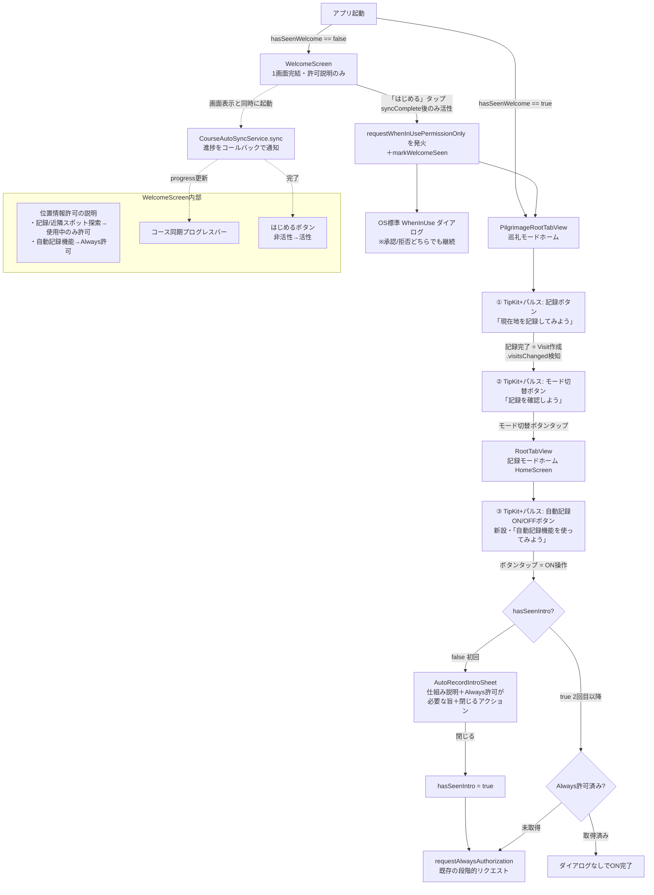
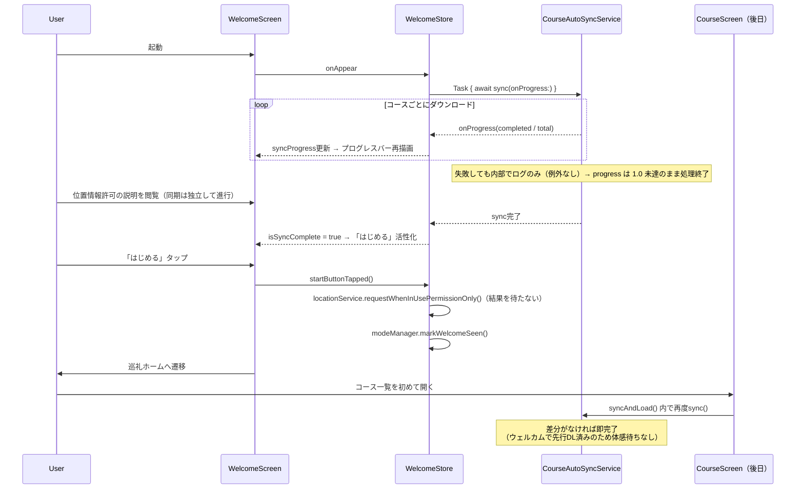
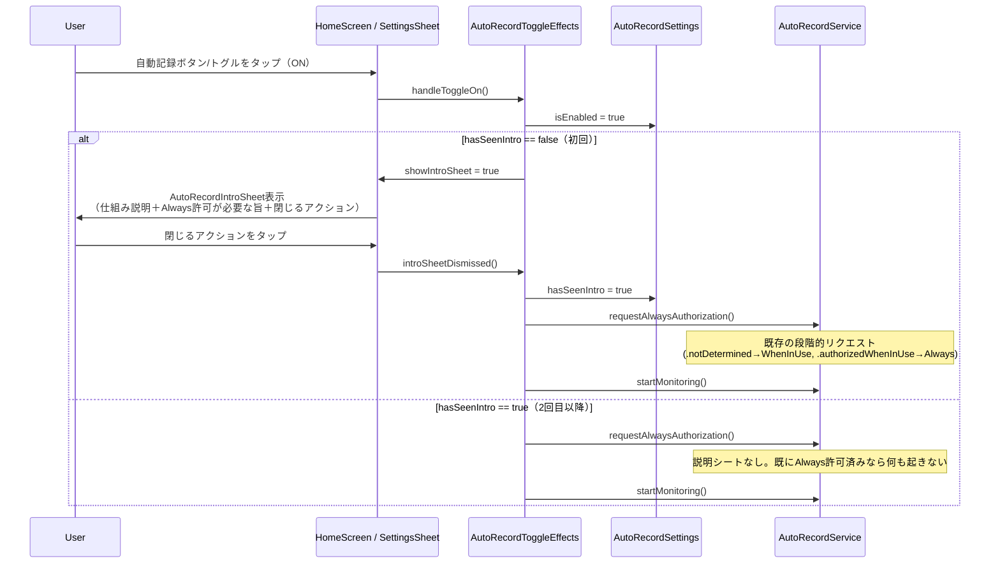

# v3.6.0 オンボーディング刷新と位置情報プライミング

## 概要

### 目的

v3.6.0のテーマは**リテンション率の向上**。以下2点を改善する。

1. **オンボーディング刷新**: モード選択UIを廃止しデフォルト巡礼モード起動にする。代わりに「ウェルカム画面」（1画面完結）を新設し、裏でコース初期同期を進めながら位置情報許可に関する説明だけを見せる。アプリの価値・機能紹介はウェルカム画面から**外し**、実際の画面上でのコーチマーク（初回チュートリアル）に役割を移す。
2. **位置情報許可プライミング**: ウェルカム画面で「記録機能・近隣スポット検索にはWhenInUse許可が必要」「自動記録機能を使うにはAlways許可が必要」の2点を説明し、「はじめる」ボタンのタップと同時にOS標準WhenInUse許可ダイアログを出す。Always許可のリクエストタイミングは現状踏襲（自動記録ON操作時のみ、オンボーディングでは求めない）。
3. **実画面コーチマーク（一連のガイド付きチュートリアル）**: TipKitを使い、巡礼ホーム→記録モードへと画面をまたいで「次にやること」を一つずつ指し示す連続ツアーにする。①巡礼ホームの記録ボタンを光らせて記録させる→②記録完了を検知してモード切替ボタンを光らせ記録モードへ誘導→③記録モードホームに新設する自動記録ON/OFFボタンを光らせてONにする操作を誘導、という3段階
4. **自動記録機能ONの初回説明シート（追加要件）**: 記録モードホームに自動記録ON/OFFボタンを新設する。これを初めてONにした瞬間、機能の仕組みとAlways許可が必要な旨を説明するシートを表示し、閉じたらAlways許可ダイアログに進む。2回目以降のON操作では説明シートを出さず、許可が未取得の場合のみ許可ダイアログを出す

### 対象ユーザー

- 新規インストールユーザー（初回起動フロー全般、初回の実画面コーチマーク）
- 既存の自動記録機能を知らない/使っていないユーザー、自動記録機能を初めてONにするユーザー（説明シート）

## 要件

### やりたいこと

- 初回起動時のモード選択UIを廃止し、デフォルト巡礼モードで起動する
- ウェルカム画面は**1画面で完結**させ、内容は**位置情報許可に関する説明のみ**にとどめる（アプリの価値・機能紹介は載せない）
  - 「記録機能や近くのスポット探索には位置情報許可（使用中のみ）が必要」
  - 「自動記録機能を使うにはAlways許可が必要（あとで設定からON可能）」
- ウェルカム画面表示と同時に裏でコース初期同期（`CourseAutoSyncService.sync()`）を実行し、**進捗をダウンロードバーとして画面に可視化する**
- 「はじめる」ボタンは**最初は非活性**で表示し、コース同期が完了したら活性化する
- 実際のOS標準WhenInUse許可ダイアログは**「はじめる」タップと同時に**発火させる
- アプリの使い方・機能紹介は**実際の画面上のコーチマーク**に置き換える。初回のみ、以下を順番にTipKitで案内する「ガイド付きツアー」にする
  1. 巡礼ホーム画面: 記録ボタン（「ここきた」ボタン）をパルスアニメーションで光らせ「現在地を記録してみよう」を表示
  2. ユーザーが記録を完了する（Visit作成）と、モード切り替えボタンを光らせて「記録を確認しよう」を表示
  3. ユーザーがモード切り替えボタンをタップして記録モードへ遷移すると、記録モードホーム画面に新設する自動記録ON/OFFボタンを光らせて「自動記録機能を使ってみよう」を表示
- 記録モードホーム画面（`HomeScreen`）に自動記録機能のON/OFFボタンを新設する（追加要件。現状は`SettingsSheet`内のトグルのみで、ホーム画面から直接ON/OFFできる導線がないため）
- 自動記録機能を**初めてON**にした瞬間、以下を含む説明シートを表示する（追加要件）
  - 自動記録機能の仕組みの簡単な説明
  - 自動記録機能を使うには位置情報の「常に許可」が必要という旨
  - 明示的に閉じるアクションのボタン（文言は「閉じる」に限らない）
  - シートを閉じたらAlways許可ダイアログ（既存の段階的リクエストフロー）に進む
  - 2回目以降のON操作ではこの説明シートを出さず、許可が未取得の場合のみ許可ダイアログだけを出す
- Always許可のリクエストタイミングは現状踏襲（自動記録ONの操作時のみ、オンボーディングでは求めない）

### 制約

- 既存の`hasSeenModeSelection`ベースの初回判定ロジックを置き換える（後方互換は不要、アプリは配布前のためマイグレーション考慮不要）
- `CourseAutoSyncService.sync()`は失敗時に例外を投げず内部でログのみ行う設計（既存挙動を変更しない）
- コーチマークは新規UI部品のため、既存ライブラリ（TipKit）と自前実装を比較し選定する
- TipKitの`popoverTip()`は吹き出しテキストのみで、対象ボタンを光らせる（パルス/グロー）演出は提供しない。テキスト部分はTipKit、視覚的な強調は自前のアニメーション修飾子を組み合わせるハイブリッド構成にする
- 自動記録ON時の説明シート表示は、新設するHome画面ボタンと既存の`SettingsSheet`内トグルの**両方の入口で共通の挙動**にする（「初めてONにしたとき」はどちらから操作しても1回きり）

## 技術調査: コーチマーク実装方式

### 比較

| 観点 | TipKit（iOS17+標準） | 自前実装（Spotlightオーバーレイ） |
|---|---|---|
| 実装コスト | 低（`.popoverTip()`をUI要素に付与するだけ） | 高（GeometryReaderで対象フレーム取得、暗転オーバーレイ、くり抜き描画を自作） |
| 見た目 | ポップオーバー吹き出し（OS標準の見た目、ダークモード自動対応） | 自由にデザイン可能（暗転+スポットライト演出等） |
| 表示条件制御 | `#Rule`マクロでBool条件を組める。ただし独自イベントカウンタは自作が必要 | 完全に自由（UserDefaultsフラグ等で自作） |
| 永続化 | フレームワークが自動管理（`Tips.configure()`で有効化） | 自前でUserDefaults管理 |
| 保守性 | Appleの標準API、OSアップデート追従は自動 | 自前ロジックの保守が必要 |

### 採用方針: ~~TipKit + 軽量な自前アニメーション修飾子のハイブリッド~~ → **完全自前実装に変更（実装後に判明した問題により方針転換）**

当初はTipKitの`popoverTip(_:arrowEdge:)`を採用した（説明は下記Sourcesの通り）。しかし実装・実機検証の結果、このアプリのカスタムタブバー（`GeometryReader`多用、`RootView`の`.rotation3DEffect`による3D変換ラッパー等）の中では、`arrowEdge`を明示しても吹き出しの位置が安定せず、横から矢印が伸びる誤表示が解消できなかった（3回の修正試行でも再現）。TipKit自体の内部ジオメトリ計算がこの複雑なレイアウトと相性が悪いと判断し、**吹き出しの表示・位置決めは完全自前実装（`CoachmarkOverlay`）に切り替えた**。

- ボタンのフレームを`GeometryReader`で直接測定し（`.global`座標系）、吹き出しをボタンの真上（または真下）に確実に配置する
- 表示要否の判定（初回のみ等）は`@AppStorage`ベースの単純なBooleanフラグに変更（TipKitの`Tip`/`@Parameter`/`#Rule`機構は撤去）
- パルス発光演出（`pulsingHighlight`）はTipKitに依存しない独立した実装だったため変更なし
- `TipKit`のimport・`Tips.configure()`・`Tip`プロトコル準拠の各構造体はすべて削除

結果として、比較検討時に想定した「TipKitの方が実装コストが低い」という前提は、少なくともこのアプリの既存レイアウト（3D変換・カスタムタブバー）においては成立しなかった。同種のコーチマークを今後追加する場合は、最初から`CoachmarkOverlay`ベースの自前実装を使う。

Sources（当初のTipKit採用検討時に参照）:
- [Mastering SwiftUI: Tipkit How to Build Smart, Contextual In-App Tips](https://medium.com/@viralswift/mastering-swiftui-tipkit-how-to-build-smart-contextual-in-app-tips-130c7d150e41)
- [How to use TipKit to create tool tips in SwiftUI](https://tanaschita.com/20240304-tipkit-feature-hints/)

## UI設計

### 画面遷移



### ウェルカム画面（WelcomeScreen）のレイアウト

内容は位置情報許可の説明のみ。アプリの価値・機能紹介は載せない（実画面のコーチマークに役割を移す）。カルーセルではなく、2つの説明ブロックを静的に並べるだけのシンプルな構成にする（内容が短く、スワイプで隠す必要がないため）。

```
┌─────────────────────────┐
│                         │
│  📍 記録・近隣スポット探索   │
│    位置情報の使用中の許可が   │
│    必要です               │
│                         │
│  🔄 自動記録機能           │
│    使うには「常に許可」が    │
│    必要です（あとで設定から   │
│    ONにできます）          │
│                         │
├─────────────────────────┤
│ ▓▓▓▓▓▓▓▓░░░░░  67%      │  ← コース同期プログレスバー
│ コースを準備しています…    │     （ダウンロードバー風の見た目）
├─────────────────────────┤
│      [ はじめる ]         │  ← 同期完了まで非活性、完了後に活性化
└─────────────────────────┘
```

- 2つの説明ブロックは常に両方表示（スワイプ不要）。内容が短いため一度に見渡せる
- 裏側のコース同期はブロックしない独立した進行。説明を読み終える頃には同期も完了している想定
- 同期が説明の閲覧より早く終わった場合は、プログレスバーは100%表示のまま「はじめる」だけが先に活性化する
- 「はじめる」タップ時: `requestWhenInUsePermissionOnly()`（許可ダイアログの発火のみ、結果を待たない）と`markWelcomeSeen()`を同時に実行し、巡礼ホームへ遷移する。許可/拒否の結果に関わらず遷移は継続する（拒否時は既存の記録操作時エラーハンドリングに委ねる）

### コーチマーク（TipKit + パルス演出）

アプリの使い方は、ウェルカム画面の説明ではなく実画面上で「一つずつ実際にやらせながら」教える、画面をまたぐ一連のガイド付きツアーにする。初回のみ、以下の順で表示する。

| 順 | Tip | 表示位置 | 演出 | 内容 | 次への進行トリガー |
|---|---|---|---|---|---|
| 1 | `RecordButtonTip` | `PilgrimageRootTabView`内の「ここきた」ボタン（[PilgrimageRootTabView.swift:275](../../kokokita/Features/PilgrimageHomeScreen/Views/PilgrimageRootTabView.swift#L275)） | `pulsingHighlight`＋TipKit popover | 「現在地を記録してみよう」 | 記録完了（Visit作成 = `.visitsChanged`通知を検知） |
| 2 | `ModeSwitchTip` | `PilgrimageRootTabView`内のモード切り替えボタン（[PilgrimageRootTabView.swift:292](../../kokokita/Features/PilgrimageHomeScreen/Views/PilgrimageRootTabView.swift#L292)） | `pulsingHighlight`＋TipKit popover | 「記録を確認しよう」 | ユーザーがモード切替ボタンをタップ（記録モードへ遷移） |
| 3 | `AutoRecordToggleTip`（新設ボタン用） | `HomeScreen`（記録モードホーム）に新設する自動記録ON/OFFボタン | `pulsingHighlight`＋TipKit popover | 「自動記録機能を使ってみよう」 | ユーザーがボタンをタップ（ON操作。以降は下記「自動記録ON時の説明シート」フローに接続） |

- 順1と順2は同じ画面（`PilgrimageRootTabView`）に同居するため、順1の完了（記録完了イベント）をトリガーに順2を表示する`#Rule`を組む。同時表示はしない
- 順2→順3は画面をまたぐ（巡礼モード→記録モード）。順3は`HomeScreen`が初めて表示され、かつ順2が完了済みの場合にのみ表示する
- パルス演出（`pulsingHighlight`）は3つのTipすべてに使う。「次にタップすべきボタン」を毎回明確に示す一貫したガイド体験にするため（他の非チュートリアル系Tip、例えば将来追加されるものは基本パルスなしのpopoverのみとする想定）
- 旧設計にあった`SettingsEntryAutoRecordTip`（設定アイコン経由の導線）は廃止。自動記録機能への導線はホーム画面の新設ボタンに一本化する。`SettingsSheet`内の既存トグルはそのまま残すが、ガイド付きツアーの対象外（Tipは付与しない）

## データ設計

### UserDefaultsフラグ

| キー | 用途 | 置き換え対象 |
|---|---|---|
| `hasSeenWelcome` | ウェルカム画面を表示済みか | 既存`hasSeenModeSelection`を置き換え |
| `appMode` | 現在のアプリモード（既存踏襲、デフォルト値を`.record`→`.pilgrimage`に変更） | 既存踏襲 |
| `autoRecord.hasSeenIntro` | 自動記録機能の説明シートを表示済みか（初めてONにした時のみ表示するためのフラグ） | 新規（`AutoRecordSettings`に追加） |

TipKitの表示済み管理はフレームワーク内部のDatastoreに委譲し、独自フラグは持たない。

### 処理の流れ（コース初期同期とボタン活性化）



### 処理の流れ（自動記録ON操作と初回説明シート）

`HomeScreen`の新設ボタン、`SettingsSheet`の既存トグルのどちらから操作しても同じ`AutoRecordToggleEffects`を経由するため、挙動は共通になる。



## 技術設計

### ファイル構成

```
kokokita/
├── App/
│   ├── AppModeManager.swift         # 改修: hasSeenModeSelection→hasSeenWelcome、デフォルトmode変更
│   └── RootView.swift               # 改修: ModeSelectionView分岐→WelcomeScreen分岐
│
├── Features/
│   ├── ModeSelectionScreen/         # 削除
│   │
│   └── WelcomeScreen/               # 新設
│       ├── Models/
│       │   └── WelcomeStore.swift           # @Observable: syncProgress, isSyncComplete
│       ├── Views/
│       │   ├── WelcomeScreen.swift          # 1画面（許可説明2ブロック＋進捗バー＋はじめるボタン）
│       │   └── Components/
│       │       ├── LocationPermissionInfoView.swift  # 「記録/近隣スポット探索」の許可説明ブロック
│       │       ├── AutoRecordPermissionInfoView.swift # 「自動記録機能」の許可説明ブロック
│       │       ├── CourseSyncProgressBar.swift        # ダウンロードバー風プログレス表示
│       │       └── WelcomeStartButton.swift           # 非活性→活性のはじめるボタン
│       │
│       └── (PilgrimageHomeScreen側の改修は下記別項)
│
├── Features/PilgrimageHomeScreen/Views/PilgrimageRootTabView.swift  # 改修: 記録ボタン・モード切替ボタンにパルス+Tip付与、記録完了検知
├── Features/HomeScreen/Views/HomeScreen.swift                       # 改修: 自動記録ON/OFFボタン新設＋Tip付与
├── Features/SettingsScreen/Views/SettingsSheet.swift                # 改修: トグルの副作用をAutoRecordToggleEffects経由に統一
│
└── Shared/
    └── Features/
        ├── Course/Services/CourseAutoSyncService.swift  # 改修: sync(onProgress:)追加
        ├── AutoRecord/
        │   ├── Services/AutoRecordSettings.swift          # 改修: hasSeenIntroフラグ追加
        │   ├── Effects/AutoRecordToggleEffects.swift       # 新設: ON操作の共通ハンドリング（説明シート要否・許可リクエスト）
        │   └── Views/AutoRecordIntroSheet.swift             # 新設: 初回説明シート
        └── Coachmark/               # 新設（複数画面で使うためShared）
            ├── Tips/
            │   ├── RecordButtonTip.swift
            │   ├── ModeSwitchTip.swift
            │   └── AutoRecordToggleTip.swift    # 表示位置をHomeScreenの新設ボタンに変更
            └── PulsingHighlight.swift   # ボタンを光らせる軽量アニメーション修飾子
```

### 主要なクラス・構造体

```swift
// Features/WelcomeScreen/Models/WelcomeStore.swift
@Observable
final class WelcomeStore {
    /// 0.0〜1.0。CourseAutoSyncService からのコールバックで更新
    var syncProgress: Double = 0
    var isSyncComplete: Bool = false

    private let autoSyncService: CourseAutoSyncService
    private let locationService: DefaultLocationService
    private let modeManager: AppModeManager

    init(
        autoSyncService: CourseAutoSyncService = AppContainer.shared.courseAutoSyncService,
        locationService: DefaultLocationService = AppContainer.shared.loc,
        modeManager: AppModeManager
    ) {
        self.autoSyncService = autoSyncService
        self.locationService = locationService
        self.modeManager = modeManager
    }

    // 画面表示と同時に呼ぶ。完了を待たせない（fire-and-forget）
    func startInitialCourseSync() {
        Task {
            await autoSyncService.sync { [weak self] progress in
                self?.syncProgress = progress
            }
            isSyncComplete = true
        }
    }

    // 「はじめる」タップ時: 許可ダイアログの発火と画面遷移を同時に行う
    func startButtonTapped() {
        guard isSyncComplete else { return }
        locationService.requestWhenInUsePermissionOnly()
        modeManager.markWelcomeSeen()
    }
}

// Shared/Features/Coachmark/Tips/RecordButtonTip.swift
struct RecordButtonTip: Tip {
    var title: Text { Text(L.Coachmark.recordButtonTitle) }       // 「現在地を記録してみよう」
    var message: Text? { Text(L.Coachmark.recordButtonMessage) }

    /// 記録完了（.visitsChanged初回検知）で true にする。PilgrimageRootTabView から更新
    @Parameter static var hasCompletedFirstRecord: Bool = false
}

// Shared/Features/Coachmark/Tips/ModeSwitchTip.swift
struct ModeSwitchTip: Tip {
    var title: Text { Text(L.Coachmark.modeSwitchTitle) }         // 「記録を確認しよう」
    var message: Text? { Text(L.Coachmark.modeSwitchMessage) }
    // RecordButtonTip の目的（記録を1件作る）が完了した後にのみ表示する
    var rules: [Rule] {
        #Rule(RecordButtonTip.$hasCompletedFirstRecord) { $0 == true }
    }

    /// モード切替ボタンをタップして記録モードへ遷移したら true にする
    @Parameter static var hasSwitchedToRecordMode: Bool = false
}

// Shared/Features/Coachmark/Tips/AutoRecordToggleTip.swift
struct AutoRecordToggleTip: Tip {
    var title: Text { Text(L.Coachmark.autoRecordToggleTitle) }   // 「自動記録機能を使ってみよう」
    var message: Text? { Text(L.Coachmark.autoRecordToggleMessage) }
    // 記録モードへの遷移が完了した後にのみ表示する（HomeScreen初回表示時）
    var rules: [Rule] {
        #Rule(ModeSwitchTip.$hasSwitchedToRecordMode) { $0 == true }
    }
}

// Shared/Features/Coachmark/PulsingHighlight.swift
// 記録ボタンをチカチカ光らせる軽量な View Modifier（TipKitでは提供されない視覚強調のみを自前で担う）
struct PulsingHighlight: ViewModifier {
    let isActive: Bool
    @State private var isPulsing = false

    func body(content: Content) -> some View {
        content
            .shadow(color: .accentColor.opacity(isActive && isPulsing ? 0.9 : 0), radius: 10)
            .scaleEffect(isActive && isPulsing ? 1.08 : 1.0)
            .onAppear {
                guard isActive else { return }
                withAnimation(.easeInOut(duration: 0.8).repeatForever(autoreverses: true)) {
                    isPulsing = true
                }
            }
    }
}

extension View {
    func pulsingHighlight(isActive: Bool) -> some View {
        modifier(PulsingHighlight(isActive: isActive))
    }
}
```

```swift
// KokokitaApp.swift 追加分
init() {
    try? Tips.configure([
        .displayFrequency(.immediate),
        .datastoreLocation(.applicationDefault)
    ])
    // 既存の初期化処理...
}
```

### 自動記録ON/OFFボタン新設と初回説明シート

```swift
// Shared/Features/AutoRecord/Services/AutoRecordSettings.swift 改修
final class AutoRecordSettings: ObservableObject {
    static let shared = AutoRecordSettings()

    private let defaults = UserDefaults.standard
    private let isEnabledKey = "autoRecord.isEnabled"
    private let hasSeenIntroKey = "autoRecord.hasSeenIntro"  // 追加

    @Published var isEnabled: Bool {
        didSet { defaults.set(isEnabled, forKey: isEnabledKey) }
    }
    @Published var hasSeenIntro: Bool {                       // 追加
        didSet { defaults.set(hasSeenIntro, forKey: hasSeenIntroKey) }
    }

    private init() {
        self.isEnabled = defaults.bool(forKey: "autoRecord.isEnabled")
        self.hasSeenIntro = defaults.bool(forKey: "autoRecord.hasSeenIntro")
    }
}
```

```swift
// Shared/Features/AutoRecord/Effects/AutoRecordToggleEffects.swift
// HomeScreenの新設ボタン・SettingsSheetのトグル、両方の入口から共通で使う副作用ハンドラ
@MainActor
@Observable
final class AutoRecordToggleEffects {
    var showIntroSheet = false

    private let settings: AutoRecordSettings
    private let service: AutoRecordService

    init(
        settings: AutoRecordSettings = .shared,
        service: AutoRecordService = AppContainer.shared.autoRecord
    ) {
        self.settings = settings
        self.service = service
    }

    // ON操作の共通入口
    func handleToggleOn() {
        settings.isEnabled = true
        if settings.hasSeenIntro {
            service.requestAlwaysAuthorization()
            service.startMonitoring()
        } else {
            // 許可リクエストは説明シートを閉じてから行う
            showIntroSheet = true
        }
    }

    func handleToggleOff() {
        settings.isEnabled = false
        service.stopMonitoring()
    }

    // AutoRecordIntroSheet の「閉じる」相当アクションから呼ぶ
    func introSheetDismissed() {
        settings.hasSeenIntro = true
        showIntroSheet = false
        service.requestAlwaysAuthorization()
        service.startMonitoring()
    }
}
```

```swift
// Shared/Features/AutoRecord/Views/AutoRecordIntroSheet.swift
// 自動記録機能を初めてONにした瞬間だけ表示する説明シート
struct AutoRecordIntroSheet: View {
    let onDismiss: () -> Void

    var body: some View {
        VStack(spacing: 24) {
            Image(systemName: "waveform.path.ecg")
                .font(.system(size: 48))
                .foregroundStyle(Color.accentColor)

            Text(L.AutoRecord.introTitle)
                .font(.title2.bold())

            Text(L.AutoRecord.introMechanismDescription)    // 仕組みの簡単な説明
                .font(.body)
                .multilineTextAlignment(.center)

            Text(L.AutoRecord.introPermissionNotice)        // Always許可が必要な旨
                .font(.subheadline)
                .foregroundStyle(.secondary)
                .multilineTextAlignment(.center)

            Button(L.AutoRecord.introDismissAction) {        // 文言は「閉じる」に限らず、例えば「使ってみる」等を想定
                onDismiss()
            }
            .buttonStyle(.borderedProminent)
        }
        .padding(32)
        .presentationDetents([.medium])
    }
}
```

```swift
// Features/HomeScreen/Views/HomeScreen.swift 改修（抜粋）
// 新設: 自動記録ON/OFFボタン（トグル代わりのアイコンボタン）＋ Tip ＋ パルス
@State private var autoRecordEffects = AutoRecordToggleEffects()
@ObservedObject private var autoRecordSettings = AutoRecordSettings.shared
private let autoRecordToggleTip = AutoRecordToggleTip()

// toolbar内に追加
ToolbarItem(placement: .topBarTrailing) {
    Button {
        if autoRecordSettings.isEnabled {
            autoRecordEffects.handleToggleOff()
        } else {
            autoRecordEffects.handleToggleOn()
            AutoRecordToggleTip.hasSwitchedToRecordMode = false // Tip解消
        }
    } label: {
        Image(systemName: "waveform.path.ecg")
            .symbolVariant(autoRecordSettings.isEnabled ? .fill : .none)
            .foregroundStyle(autoRecordSettings.isEnabled ? Color.accentColor : .secondary)
    }
    .pulsingHighlight(isActive: !autoRecordSettings.isEnabled)
    .popoverTip(autoRecordToggleTip)
}
// .sheet(isPresented: $autoRecordEffects.showIntroSheet) {
//     AutoRecordIntroSheet(onDismiss: { autoRecordEffects.introSheetDismissed() })
// }
```

### DefaultLocationServiceへの追加

「はじめる」タップ時は「位置情報取得」ではなく「許可リクエストのみ」を行いたいため、`requestOneShotLocation()`とは別に許可専用メソッドを追加する。結果を待つ`CheckedContinuation`は使わず、発火のみで即returnする（画面遷移をブロックしないため）。

```swift
// DefaultLocationService.swift に追加
func requestWhenInUsePermissionOnly() {
    guard manager.authorizationStatus == .notDetermined else { return }
    manager.requestWhenInUseAuthorization()
}
```

### CourseAutoSyncServiceへの進捗コールバック追加

既存の`sync()`は戻り値なし・進捗通知なしの設計。プログレスバー表示のため、ダウンロード件数ベースの進捗を通知するオプショナル引数を追加する。既存呼び出し元（`CourseListStore.syncAndLoad()`）は引数省略で変更なしのまま動作する非破壊な拡張。

```swift
// CourseAutoSyncService.swift 改修
func sync(onProgress: (@MainActor (Double) -> Void)? = nil) async {
    do {
        let index = try await storeService.fetchIndex()
        let localCourses = try courseRepo.fetchAll()
        // ...既存の differential 判定...

        let targets = index.courses.filter { /* needsDownload 判定 */ }
        let total = max(targets.count, 1)
        var completed = 0

        for summary in targets {
            // ...既存のダウンロード処理...
            completed += 1
            await onProgress?(Double(completed) / Double(total))
        }
        // ...既存の削除・通知処理...
    } catch {
        Logger.error("コース自動同期エラー", error: error)
        await onProgress?(1.0)  // 失敗時もプログレスバー・ボタンをブロックしたままにしない
    }
}
```

`targets`が0件（同期不要）の場合は`total=1, completed`をループなしで即`onProgress?(1.0)`を呼ぶガードを入れる。

## エラーハンドリング

| ケース | 対処 |
|---|---|
| ウェルカム画面中のコース同期が失敗（オフライン等） | `sync()`はcatch節で`onProgress?(1.0)`を呼び、進捗100%扱いにして「はじめる」を活性化させる（同期エラーでオンボーディングをブロックしない）。ユーザーが後日`CourseScreen`を開いた際に既存`syncAndLoad()`が再同期を試みるため機能的な欠落はない |
| 「はじめる」タップ時にWhenInUse許可が拒否された | 画面遷移はブロックしない。既存の`LocationServiceError.permissionDenied`ハンドリングをそのまま踏襲し、初回の記録操作時に改めてエラー表示・許可導線が走る |
| 同期が極端に遅い（低速回線等） | 「はじめる」は同期完了まで非活性のままで待たせる設計。上限タイムアウトは設けない（コース総数・容量は小さい想定）。将来的に長時間化する場合は「あとで読み込む」の逃げ道を検討（今回はスコープ外） |
| TipKitの表示条件が重複（複数Tipが同時に表示条件を満たす） | `#Rule`で表示順序を制御し、同時表示を避ける（`RecordButtonTip`→`ModeSwitchTip`→`AutoRecordToggleTip`の一方向のみ進行） |
| 記録ボタンで記録を試みたが位置情報エラー等で記録に失敗した | `RecordButtonTip`は解消しない（`hasCompletedFirstRecord`が更新されないため）。ユーザーは再度記録を試せる。次のコーチマークへは進まない |
| ユーザーが記録モードへ切り替えず、直接ホームタブなど他の操作をした | `ModeSwitchTip`は表示され続ける（TipKitのpopoverは他操作を妨げない）。強制はしない |
| 自動記録ONの説明シート表示中にアプリがバックグラウンドに回った | シート状態は`showIntroSheet`（Viewのローカル状態に近い@Observable）で保持されるため、フォアグラウンド復帰後も表示は継続する。許可リクエストはシートの明示的な「閉じる」操作でのみ発火するため、意図しないタイミングでは走らない |
| 自動記録ONの説明シートを閉じた直後にAlways許可が拒否された | 画面表示はブロックしない。`isEnabled`はtrueのままだが、`AutoRecordService.startMonitoring()`は権限不足時にOS側で監視が実質的に機能しないだけで、アプリ側は明示的なエラー表示をしない（既存の`AutoRecordService`にエラーハンドリングがないため踏襲）。将来的にトグル行に権限不足の警告表示を追加する余地はあるが今回はスコープ外 |

## テスト観点

- [ ] 初回起動でモード選択UIが表示されず、直接WelcomeScreenが表示される
- [ ] WelcomeScreen完了後、`appMode`が`pilgrimage`になっている
- [ ] コース同期の進捗がプログレスバーにリアルタイムで反映される
- [ ] 同期完了前は「はじめる」が非活性、完了後に活性化する
- [ ] ウェルカム画面にアプリの価値・機能紹介の文言が含まれていない（位置情報許可の説明2点のみ）
- [ ] オフライン状態でも同期が失敗扱いで完了し、「はじめる」が活性化する（無限に非活性のままにならない）
- [ ] 2回目以降の起動でWelcomeScreenが表示されない
- [ ] 「はじめる」タップでOS標準WhenInUseダイアログが表示され、許可/拒否どちらでも巡礼ホームへ遷移する
- [ ] 初回の巡礼ホーム画面で記録ボタンがパルス発光し、`RecordButtonTip`が表示される
- [ ] 記録を1件完了（Visit作成）すると記録ボタンの発光が止まり、モード切替ボタンが光り`ModeSwitchTip`（「記録を確認しよう」）が表示される
- [ ] モード切替ボタンをタップして記録モードへ遷移すると、`HomeScreen`の新設ボタンが光り`AutoRecordToggleTip`（「自動記録機能を使ってみよう」）が表示される
- [ ] `HomeScreen`に自動記録ON/OFFボタンが表示され、タップでON/OFFが切り替わる
- [ ] 自動記録を初めてONにすると`AutoRecordIntroSheet`が表示され、閉じるとAlways許可ダイアログに進む
- [ ] 2回目以降の自動記録ON操作では`AutoRecordIntroSheet`が表示されない
- [ ] 2回目以降でAlways許可が未取得の場合は許可ダイアログのみ表示される。取得済みの場合は何も表示されずONになる
- [ ] `HomeScreen`の新設ボタンと`SettingsSheet`のトグル、どちらから操作しても`hasSeenIntro`は共有され、片方で説明シートを見たらもう片方でも再表示されない
- [ ] 3つのTip（記録ボタン・モード切替・自動記録トグル）が初回のみ表示され、2回目以降は出ない
- [ ] Always許可はオンボーディング中にリクエストされず、自動記録ON操作時にのみリクエストされる（既存挙動の非破壊確認）
- [ ] `CourseListStore.syncAndLoad()`など既存の`sync()`呼び出し元が引数省略のまま動作する（後方互換確認）
- [ ] ローカライズ: 新規文言がすべて`L`列挙型経由、ja/en両方に存在する

## 実装メモ

### ポイント

- `AppModeManager`のデフォルト値変更は`init()`内の`AppMode.record.rawValue`を`AppMode.pilgrimage.rawValue`に変更するだけで済む（[AppModeManager.swift:22](../../kokokita/App/AppModeManager.swift#L22)）。`RootView.savedMode()`側のデフォルトも同様に合わせる（[RootView.swift:67](../../kokokita/App/RootView.swift#L67)）
- `ModeSelectionScreen`ディレクトリは削除するが、`AppMode`列挙型自体（記録/巡礼の値）は設定画面のモード切替で引き続き使うため残す
- コース同期の二重実行（Welcome画面での先行同期 と CourseScreen初回表示時のsyncAndLoad）は`CourseAutoSyncService.sync()`が冪等（`needsDownload`判定で差分のみ処理）なため問題なし。特別な排他制御は不要
- TipKitは`Tips.configure()`をアプリ起動時に一度呼ぶ必要がある（未呼び出しだとTipが表示されない）
- プログレスバーの進捗値はダウンロード**件数**ベース（コースごとの容量差は考慮しない）。コース数が少ない現状ではこれで十分自然に見える想定。将来コース数・容量が増え体感とズレる場合はバイト数ベースへの変更を検討
- 「はじめる」タップ時の`requestWhenInUsePermissionOnly()`はfire-and-forget（結果を待たない）ため、OS標準ダイアログが表示されている最中に裏で巡礼ホームへの画面遷移が進む。これはiOSの仕様上正常な挙動（許可ダイアログは常に最前面のシステムオーバーレイとして表示される）
- `pulsingHighlight`はそれぞれのTipが表示されている間だけ`isActive: true`にする。Tipが解消されたら`isActive: false`にしてアニメーションを止める。無期限に光り続けないよう、各Tipの解消フラグと連動させる
- 記録完了の検知は既存の`.visitsChanged`通知を再利用する。新規のイベント基盤は作らない。`PilgrimageRootTabView`（または`PilgrimageHomeView`）で`.onReceive(NotificationCenter.default.publisher(for: .visitsChanged))`を購読し、`RecordButtonTip.hasCompletedFirstRecord`が未だfalseなら初回の通知でtrueにする
- `AutoRecordToggleEffects`は`HomeScreen`・`SettingsSheet`それぞれで`@State`により個別にインスタンス化してよい（シングルトンにする必要はない）。永続状態（`isEnabled`・`hasSeenIntro`）は`AutoRecordSettings.shared`に一元化されているため、どちらの画面から操作しても整合性が保たれる
- `SettingsSheet`の既存トグルの`onChange`ハンドラも`AutoRecordToggleEffects.handleToggleOn()/handleToggleOff()`を呼ぶ形に置き換え、ON時の説明シート分岐ロジックを重複実装しない

### 参考

- 既存の自動記録機能設計書: `doc/auto-record-feature-design.md`（6章で権限段階取得のベストプラクティスを既に整理済み。今回の設計はこれと整合）
- 既存の「使い方」シート: `PilgrimageHowToUseSheet.swift`（設定/ホームから任意に開ける詳細ガイド。今回のウェルカム/コーチマークとは役割が異なる＝こちらは「いつでも見返せる詳細説明」、ウェルカムは「初回だけの導入」）

## 未決事項 / 要検討

1. ウェルカム画面2ブロックの具体的な文言・アイコン（コピーライティングは別途詰める）
2. プログレスバーの視覚表現（単純な水平バーか、より演出的なアニメーションか）
3. パルス演出の具体的なパラメータ（発光の色・速度・持続時間）
4. 3段階の順序制御（`RecordButtonTip`→`ModeSwitchTip`→`AutoRecordToggleTip`）を、TipKitの`#Rule`＋`@Parameter`だけで組めるか、一部を`@AppStorage`の独自フラグで補助するか
5. `HomeScreen`新設ボタンの具体的な見た目・配置（今回はツールバーアイコン案を仮置き。バナー/チップ等の他案も含め最終的なビジュアルは別途確認）
6. `AutoRecordIntroSheet`の「閉じる」相当ボタンの具体的な文言（「使ってみる」「はじめる」等の案がある。コピーライティングは別途詰める）
7. 実画面コーチマークを3ボタン（記録・モード切替・自動記録トグル）以外にも広げるか（例: コースタブ、マイリストタブ等）は今回のスコープ外とし、まずはこの3つの導線から始める
8. 同期が数秒で終わった場合と長引いた場合とで、プログレスバーの見せ方に差をつけるか（例: 一定時間経過で「もう少しお待ちください」等のメッセージ切り替え）

## 変更履歴

- 2026-08-02: 初版作成
- 2026-08-02: ウェルカム画面を「1画面完結・スライドカルーセル＋コース同期プログレスバー＋非活性→活性のはじめるボタン」構成に変更。位置情報許可ダイアログは「はじめる」タップ時に発火する方式に確定。`CourseAutoSyncService.sync()`に進捗コールバックを追加する設計を追記
- 2026-08-02: ウェルカム画面からアプリの価値・機能紹介スライドを撤去し、位置情報許可の説明（WhenInUse/Always）のみの1画面2ブロック構成に変更。代わりに実画面上のTipKitコーチマークで使い方を教える方針に転換。記録ボタンをパルス発光させる`RecordButtonTip`を新設し、`RecordButtonTip`→`ModeSwitchTip`→`SettingsEntryAutoRecordTip`→`AutoRecordToggleTip`の4段階コーチマーク導線を確定
- 2026-08-02: コーチマーク導線を「記録ボタン→（記録完了）→モード切替ボタン『記録を確認しよう』→（記録モードへ遷移）→記録モードホーム新設の自動記録ON/OFFボタン」の3段階に再設計（`SettingsEntryAutoRecordTip`は廃止）。記録モードホーム画面(`HomeScreen`)に自動記録ON/OFFボタンを新設する追加要件を反映。自動記録機能を初めてONにした際に仕組み説明＋Always許可の必要性を伝える`AutoRecordIntroSheet`を新設し、2回目以降はスキップして許可ダイアログのみ出す`AutoRecordToggleEffects`の設計を追加
- 2026-08-02: 実装・実機検証の結果2件を反映。①コーチマークはTipKitの`popoverTip`が既存のカスタムタブバー（3D変換・GeometryReader多用）で位置計算を誤るバグが解消できなかったため、フレーム直接測定による完全自前実装`CoachmarkOverlay`に置き換え。TipKit関連コードは全撤去。②`DefaultLocationService.locationManagerDidChangeAuthorization`に、許可ダイアログ表示前後の中間コールバック（status=notDeterminedのまま発火）でcontinuationを誤って解決してしまうバグを発見し修正（実機ログで許可状態0・permissionDeniedのまま失敗していたことから特定）
