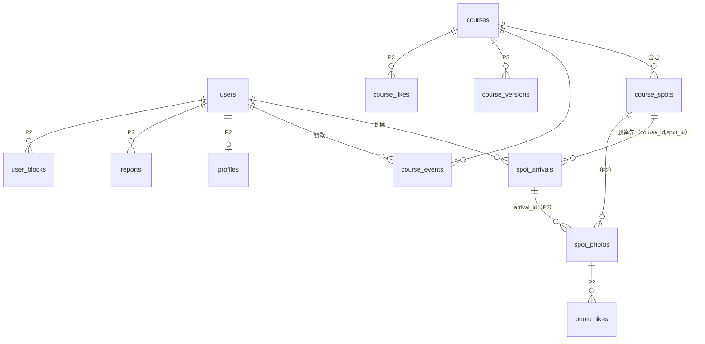

# ココキタ サーバー機能 設計書（メタ情報・写真投稿・コース投稿）

最終更新: 2026-11-03（現行実装との整合性確認を反映）

## 実装前に必ず確認すること

- 新規サービス・Storeの実装は `CLAUDE.md` の「クリーンアーキテクチャ（Domain/Infrastructure/Presentation層）」という記述ではなく、**`doc/architecture/architecture-guide.md` が定める Feature-based MV パターン**（`@Observable` Store、Protocol-based DI廃止、具象型への直接依存）に従うこと。CLAUDE.mdのレイヤ構成の記述は移行前の古い内容。
- 本設計書は現行コードベース（`kokokita/Shared/Features/Course/` 配下のコース機能、`DefaultIntegrityService`、`AppContainer` 等）との整合性を確認済み。以下の章に、確認の過程で見つかった前提のズレと対応方針を反映している。

## 概要と設計方針

結論：**フェーズ1（メタ情報）の時点で「匿名ユーザーID」「公式/ユーザー共通のcoursesテーブル」「coursesと対になるcourse_spotsテーブル」の3つを入れておけば、写真投稿とコース投稿は後からテーブル追加だけで載せられる。**

実装順は メタ情報収集 → スポット写真投稿 → 自作コース投稿。いずれもサーバーにユーザー由来データを持つ初めての機能なので、DBと認証の土台はフェーズ1で3機能分まとめて作る。

### 現状の前提

- 記録データはすべて端末内（CoreData）。ログインなし
- コースJSONは S3 + CloudFront の静的配信（`/course/store/index.json`、`/courses/{id}.json`）。APIサーバーはない
- 全コースが自動ダウンロードされる。コースストア画面はなく、コースの非表示・削除機能もない
- Lambda は NGワードチェックなどで利用済み
- 「ログイン不要・データは端末内」をストアでも訴求している

### 設計方針

1. **ログイン不要は維持する。** 匿名認証で裏側にユーザーIDを発行し、ハンドルネーム設定時やSign in with Apple連携時に同じIDを引き継ぐ
2. **送るのは「到達したスポット」だけ。** 生のGPS軌跡や日常の訪問記録（カフェ等）はサーバーに送らない
3. **公式コンテンツ配信は今のS3/CloudFrontのまま。** 書き込みと集計だけを新しいバックエンドに任せる
4. **到達記録が「証明」の起点。** 写真投稿は到達記録に紐づけ、到達した人しか投稿できない設計にする（GPS証明というブランドと一致）

## 最初に決める基盤判断

推奨は **Supabase（Postgres + 匿名認証 + Storage）を書き込み・集計用に追加し、公式コース配信はS3/CloudFrontに残す**構成。いいね数・ランキング・集計などリレーショナルな処理が中心なので、RDBが素直に書ける。

### バックエンド選定

| 候補 | 向いている点 | 懸念 |
| --- | --- | --- |
| Supabase（推奨） | Postgres で集計・ランキングがSQLで書ける。匿名サインイン→Apple連携の引き継ぎ、RLSで行単位の権限、Storage、Swift SDKが揃う | AWSと2系統の運用になる |
| Firebase（Firestore） | 匿名認証が成熟、iOS SDKが厚い | 集計・ランキング・複合検索が苦手で、カウンタや集計用ドキュメントを自前管理 |
| AWS（API Gateway + Lambda + Aurora/DynamoDB + Cognito） | 既存インフラと統一 | 個人開発には構築量が多い。認証まわりの実装負荷が大きい |

※サービス仕様は記憶ベース。採用前に各社の最新ドキュメントと料金を確認する。

### ユーザー識別

- フェーズ1から**匿名認証**でユーザーIDを発行（サーバー側の `auth.uid`）。以前検討した Keychain UUID の役割をこれが担う
- セッションは Keychain に保存し、再インストールでも同じIDを使えるようにする
- フェーズ2のハンドルネーム設定時に **Sign in with Apple 連携を任意で提示**。連携すると機種変更でも投稿・いいねを引き継げる
- 端末内の訪問記録は今まで通りCoreDataが正。サーバーは「到達スポット」の写しだけを持つ

### 画像ストレージ

- ユーザー投稿写真は Supabase Storage か既存S3のどちらか。CDN配信をそろえるなら **S3 + CloudFront（アップロードは署名付きURL）** が一貫する
- アップロード前に端末側でリサイズ（長辺1600px程度）し、**EXIF（位置情報含む）を除去**する

### 不正対策

- 到達はクライアント申告なので、サーバー側でも スポット座標との距離・到達時刻・短時間の大量到達 をチェックする
- 必要になれば App Attest でアプリ以外からのAPI呼び出しを弾く

## 全体DB設計

3機能のテーブルを最初から1つのスキーマで定義し、フェーズごとに使い始める。核になるのは **users / courses / course_spots / spot_arrivals** の4つで、これはフェーズ1で作る。



写真（P2）は到達記録を必ず参照し、投稿コース（P3）は公式と同じ courses に `source=community` で入る。P1の4テーブルが後続すべての土台になる。

> **places（スポットの正規ID）は意図的に作らない。** 当初は「姫路城は100名城コースにも世界遺産コースにも登場するので、場所の実体を1つにまとめて集計を合算する」places設計を検討したが、実装時に見送った。理由は2つ：(1) 同じ実在の場所でも**コースごとに到達判定の半径や文脈が異なる**ため、別々の到達として数えるのが実態に合っている。(2) 聖地巡礼の写真は「このアニメのこのシーンと同じアングル」等**コースの文脈に強く依存**し、場所単位でプールすると無関係な写真が混ざって害になる。到達者数・「◯人目」・写真（P2）はすべて `(course_id, spot_id)` 単位で独立に扱う。

### 最初から決めておく4つのこと

1. **coursesは公式とユーザー作成を同じテーブルに。** `source` 列（`official` / `community`）で区別し、ストア・ダウンロード・集計の仕組みを共通化する
2. **spotIdは一度付けたら変えない。** バージョン更新でスポットの並べ替えや削除があっても、既存のspotIdを振り直さない（集計キーが壊れるため）。仕様書に明記する
3. **削除は論理削除＋ステータス列。** 投稿・コースは `status` で公開/非公開/削除を管理。アカウント削除時だけ物理削除（カスケード）
4. **courseIdの生文字列を端末のCoreDataにも保持する。** 現行の `CourseEntity.id` は、JSONの文字列ID（例: `course-world-heritage-japan-001`）を `CourseJSONParser.uuidFromString()` で一方向ハッシュ化したUUIDのみを保持しており、元の文字列はどこにも残らない（1階層下の `CourseSpotEntity.spotId` / `CourseSectionEntity.sectionId` は文字列を別フィールドで保持済みだが、`CourseEntity` だけこの対になるフィールドが無い）。`spot_arrivals.course_id` をサーバーに送るには、この生文字列がまず端末側に必要。P1の最初のタスクとして、`CourseEntity` に文字列IDフィールドを追加するCoreDataマイグレーションを行う（詳細は後述の「courseId生文字列マイグレーション」を参照）

### テーブル一覧

| テーブル | 主な列 | 使い始め |
| --- | --- | --- |
| users | id（=auth.uid）, created_at, apple_linked, deleted_at | P1 |
| courses | id(text), source, owner_id, title, summary, categories, current_version, status, published_at | P1 |
| course_spots | course_id, spot_id, name, lat, lng, order_index | P1 |
| spot_arrivals | id(端末側で(visitId,spotId)から導出した決定論的UUID), visit_id(=端末側の記録UUID), user_id, course_id, spot_id, arrived_at, distance_m, app_version | P1 |
| course_events | user_id, course_id, version, type（view）, at | P1 |
| course_stats | 訪問者数・到達数・閲覧数・達成数（集計結果、(course_id,spot_id)単位） | P1 |
| profiles | user_id, handle（一意）, display_name, created_at | P2 |
| spot_photos | id, user_id, course_id, spot_id, arrival_id, storage_path, caption, status, like_count, created_at | P2 |
| photo_likes | photo_id, user_id, created_at | P2 |
| reports | id, reporter_id, target_type, target_id, reason, status | P2 |
| user_blocks | blocker_id, blocked_id | P2 |
| course_versions | course_id, version, body(jsonb), spot_count, published_at | P3 |
| course_likes | course_id, user_id, created_at | P3 |

> **`courses.source` とクライアントの `source` は値が異なる。** クライアント側のコースJSON仕様（`doc/features/course/course-json-spec.md`）では `source` は `"downloaded"` / `"user"`（旧 `"bundled"` は廃止済み）。サーバーDBの `official` / `community` とは語彙が異なるため、同期・投稿APIの境界で `downloaded ↔ official`・`user ↔ community` のマッピングを行う。クライアント側JSONの `source` 値自体は変更しない（既存の自動同期ロジックへの影響を避ける）。

> **`spot_arrivals.id` は到達記録の訪問IDそのものにはできない。** 既存の `CourseRecognitionService.recognize()` は、1件のGPS記録（Visit）が認識半径の重なりや複数コースへの同時該当によって**複数のコーススポットに同時ヒットする**ことを許容する設計（同一コース内複数該当・複数コース該当は全件返す）。そのため `spot_arrivals.id` を単純に visitId とすると、同じvisitが複数スポットにヒットした際に2件目以降が欠落する。`id` は端末側で `(visitId, spotId)` から導出した決定論的UUIDとし、`visit_id` 列を別途持たせて元のVisitへの参照を保持する。

### courseId生文字列マイグレーション（P1最初のタスク）

- `CourseEntity` に `rawId: String?`（optional、既存行はnilからスタート）を追加する軽量マイグレーション
- **公式コース（`source == .downloaded`）**：ハッシュは非可逆だが、運営側は配信中の全コースJSONの文字列IDを把握している。新規の一回限りマイグレーションスクリプトではなく、**既存の `CourseAutoSyncService.sync()` のマッチングループに統合**し、`index.json` の各 `summary.id` を `uuidFromString()` で変換して既存ローカル行を見つけた際に `rawId` へ書き込む。この方式なら新しいタイミング問題を増やさず、毎起動時に自然とバックフィルが完了する
- **ユーザー作成コース（`source == .user`）**：生成時の文字列IDは一切永続化されていないため復元不可能。これまで外部システムに見せたことが無いIDなので、マイグレーション時に既存命名規則（`course-user-{UUID下8桁}-001`、`doc/features/course/course-creation.md` 参照）で新規に文字列IDを発行して問題ない
- `rawId` が未確定（nil）の間は、そのコースに関する `spot_arrival` 送信を保留し、バックフィル完了後にリトライする
- この変更に伴い、P3のユーザー投稿コースIDも新規に `ucourse-{uuid}` 形式を導入するのではなく、**既存の `course-user-{UUID下8桁}-001` 形式をそのまま使う**（命名規則を1つに統一し、既存のマイリスト機能との食い違いを避ける）

### 既存JSON仕様への追加

- SpotJSONへの追加フィールドは不要（placeId等は導入しない。到達記録は`course_id`+`spot_id`で完結する）
- 公式コースのcourses/course_spotsは `tools/course-pipeline/sync_courses_to_supabase.py` が本番配信中の `store/index.json` 経由でコースJSONを取得し、Supabaseへupsertする（新規スクリプト。SpotJSONのgooglePlaceIdは形骸化しており使用しない）
- コースJSONに `author`（ハンドルネーム）を追加。既存の `source`（`downloaded`/`user`）フィールドで公式/コミュニティは判別できるため、重複する `origin` フィールドは追加しない
- ユーザー投稿コースのID・スポットIDは、新規の命名規則を増やさず既存の `course-user-{UUID下8桁}-001` / `{コース略称}-{3桁連番}` 形式を維持する（上記「courseId生文字列マイグレーション」参照）

## フェーズ1 メタ情報収集

ゴール：**「人気コース」「よく訪問されるスポット」をコース一覧とスポット画面に出せる状態にする。** ユーザーに見える変化は小さいが、認証・DB・送信基盤をここで完成させる。

### 収集するデータ

端末から送るのは **spot_arrival と course_event（関心度イベント）の2種類だけ**。達成や挑戦中の判定はサーバー側で到達記録から算出する。

| データ | 端末から送るか | 内容 | 用途 |
| --- | --- | --- | --- |
| spot_arrival | 送る | 記録UUID, course_id, spot_id, arrived_at, スポットまでの距離, アプリバージョン | 到達者数、「◯人目」表示、写真投稿の権利 |
| course_event（view） | 送る | course_id, 閲覧日（同一コースは1日1回まで） | 関心度。到達が少ない初期の人気指標 |
| course_event（favorite_add） | 送る | course_id, 追加日（同一コースは1日1回まで。削除は送らない一方向シグナル） | 関心度。お気に入り追加は閲覧より強い興味の表明 |
| course_event（spot_favorite_add） | 送る | course_id, spot_id, 追加日（同一スポットは1日1回まで。削除は送らない） | 関心度。コース単位より細かい、スポット単位の興味の表明 |
| コース達成 | 送らない | 到達記録と course_spots からサーバーで判定 | 達成者数、達成率 |
| 挑戦中ユーザー | 送らない | コース内で1スポット以上到達したユーザー | 人気指標 |

- コース外の訪問記録（カフェ・日常の記録）と生のGPS座標履歴は送らない
- 全コースが自動ダウンロードされ、非表示・削除機能もないため、ダウンロード・削除は収集しない

### 送信のタイミング

既存実装では `RecordingController.runCourseRecognition()`（`VisitFormStore` / `AutoRecordCandidateStore` / コース遡り承認の3経路から共通で呼ばれる、コース認識とチェックインを確定する唯一のポイント）がこの送信のトリガーになる。

1. **即時送信：** 記録確定時にその1件を送り、レスポンスで「◯人目」を受け取る。**記録の確定（CoreData保存・UI反映）自体は送信を待たずに完了させ、送信とレスポンス受信は非同期で行う。** 記録確定のクリティカルパスにAPI呼び出しを同期的に挟むと、「ログイン不要・いつでもすぐ記録できる」という体験が電波状況に左右されてしまうため
2. **同期：** アプリ起動時とフォアグラウンド復帰時に、未送信の到達記録をまとめて送る。端末側は記録ごとに送信済みフラグを持つ。即時送信の失敗やオフライン記録もここで埋まる
3. **初回同期：** 同意直後の初回は、機能実装前のものも含めて到達記録を全件送る。過去分のための一括アップロード処理は別に作らない
4. **course_event（関心度イベント）：** 端末に貯めておき、同期時にまとめて送る

### 集計ルール

- **追記型：** サーバーは記録UUIDで追加するだけ。端末で記録を削除しても集計からは消さない
- 到達者数と順位は **ユーザー × (course_id, spot_id) で一意**。同じスポットの再訪や、削除後の再記録は数えない（placesを作らない方針のため、集計キーはcourse_id+spot_idの組）
- 「◯人目」の順位は最初の到達時刻で決め、一度付けたら変えない
- コース達成：その時点の course_spots の全スポットに到達したら達成とする
- **コースのバージョン更新でスポットが追加されても、既存の達成者の達成状態は遡って取り消さない。** 達成は「その時点のスポット集合に対するスナップショット」として扱う。クライアント側の `CourseAutoSyncService` も既にバージョン更新時にチェックイン状態を保持する実装になっており、挙動を一致させる。「達成済みなのに後から取り消される」はGPS証明というブランドの信頼を損なうため、仕様として確定する（旧・未決事項）
- 不正チェック（スポットとの距離・時刻・短時間の大量到達）に引っかかった記録は保存するが集計から除外する
- 1日1回のバッチで course_stats を更新し、**静的JSON（`/course/store/stats.json`）としてS3に書き出す**。アプリはCDN経由で読むのでDBに読み取り負荷がかからない
- バッチの実行先は**AWS Lambda（EventBridge Schedulerで1日1回起動）**。既存のNGワードチェック用Lambdaと同様にAWS側に集約し、S3書き込み・CloudFrontキャッシュ無効化はIAMロールで行う（AWS側にSupabaseのservice_roleキーを持たせない設計。集計自体はSupabase側の`compute_course_stats` RPC——`security definer`で全ユーザー横断集計を行うが、返すのは集計済みの数値のみ——をanonキーで呼ぶだけで完結する）。実装は`tools/course-stats-batch/`

### stats.json の構造

既存の `store/index.json` と同じ `schemaVersion`/`generatedAt` パターンに揃え、クライアント側の読み込みコードを再利用しやすくする。

```json
{
  "schemaVersion": 1,
  "generatedAt": "2026-11-20T00:00:00Z",
  "minDisplayCount": 10,
  "courses": {
    "course-world-heritage-japan-001": {
      "challengerCount": 143,
      "completedCount": 12,
      "spots": {
        "wh-jp-001": { "arrivalCount": 87 },
        "wh-jp-002": { "arrivalCount": 54 }
      }
    }
  }
}
```

- `courses` は course_id をキーにしたオブジェクト（配列ではなくキー検索しやすい形）
- `challengerCount`: そのコースで1スポット以上到達した人数（挑戦中）
- `completedCount`: そのコースの全スポットに到達した人数（達成）
- `spots` は spot_id をキーにした到達者数（`arrivalCount`）
- **`minDisplayCount` 未満のコース・スポットはJSON自体に含めない。** 0〜9人の値を送らず、クライアントは「エントリが無ければバッジを出さない」と判断する（厳密な数値を公開ファイルに載せない、という副次的な利点もある）

### 表示

- コース一覧の「人気」並び替え、コースカードの「◯人が達成」「◯人が挑戦中」、スポットの「◯人が到達」
- 少人数のうちは逆効果になりうるので、**一定数（`minDisplayCount`、例：10人）未満は非表示**にする（stats.json生成時にバッチ側で除外する）
- 個人開発のローンチ直後は母数がほぼゼロで、この人気指標が長期間まったく表示されない「無風期間」が生じる。P2で予定している運営手動の固定フラグ（代表写真の固定・除外用）と同様の仕組みを**P1から前倒しで用意**し、運営が手動で「ピックアップ」コースを目立たせられるようにする。DB集計が機能するまでの橋渡しとする

### 到達時の「◯人目」表示

P1で唯一ユーザーに見える機能。同意画面だけのリリースにしないための目玉で、少人数の時期でも「1人目の到達者」として価値が出る。

- 即時送信のレスポンスで、その(course_id, spot_id)での順位を返す。集計バッチは待たない
- 2回目以降の到達では「◯人目として到達済み」を表示
- 達成シートに「このスポットに到達した◯人目」を表示。1人目・10人目・100人目などの節目は演出を強める
- オフラインで記録した場合は、同期時に順位を受け取って記録に保存し、記録詳細で確認できる
- 過去分は到達日時順に順位を付ける。過去の記録に後から順位を見せるかは演出として選ぶ（例：記録詳細にだけ表示）
- 順位は端末のCoreDataにも保存し、オプトアウト後も表示できるようにする

### 同意とオプトアウト

- **方式：デフォルトオン（オプトアウト方式）。** 明示的な同意ボタンを押させる方式（オプトイン）は検討したが、
  以下の理由で不採用とした（2026/11/22 ユーザーと合意）：
  - 送信するのは匿名ID（ログイン不要のまま）＋到達記録・コース閲覧/お気に入りの情報のみで、
    ログインやアカウント登録、広告トラッキング（IDFA等）とは無関係。Apple ATTの対象外であり、
    App Store上もオプトインを強制される類のデータではない
  - 「ログイン不要・いつでもすぐ記録できる」というブランドとの一貫性を優先し、初回起動時に
    余計な選択を迫らない。説明はウェルカム画面の設定説明（位置情報許可等と同じ並び）に含める
  - 一方で、**完全にオフにできない仕様（オプトアウト自体を禁止）は採用しない。** GDPR等では
    同意ベースの処理は「同意を取り下げる権利」が撤回時と同じ手軽さで保証される必要があり、
    匿名とはいえ位置情報由来のデータを扱う以上、設定からいつでもオフにできる状態を維持する
- ウェルカム画面（初回起動時）で、位置情報許可等と同じ並びで簡潔に説明する（システム許可ダイアログは伴わない、読むだけの説明）
- 設定画面に送信のオン/オフスイッチを常時表示する。オフでも記録機能はすべて使える。トグルのラベル文言は
  オン/オフの状態に関わらず常に同じにする（以前は状態によって文言が変わり分かりにくかったため統一した）
- 詳しい説明は設定画面の「詳しく見る」から読める（`MetaCollectionInfoSheet`。同意ボタンは無く、読み物として閉じるだけ）
- 自分のデータを消したい人のために、設定に「サーバーのデータを削除」を常時表示する（オフの状態でも、過去に送信済みのデータがあれば削除できる）

### 未決事項（P1）

（P1発足時点の未決事項は上記「courseId生文字列マイグレーション」「達成のスナップショット方針」として解消済み。新たな未決事項が出れば随時追記する）

## フェーズ2 スポット写真投稿とハンドルネーム

ゴール：**到達した人だけが写真を投稿でき、いいねの多い写真がスポットの代表写真になる。** 「GPSで到達を証明した人の写真」であることが他の写真サービスとの違いになる。

### ハンドルネーム（profiles）

- 初めて投稿するときに設定を求める（それまでは不要）
- handle：英数字と_、3〜20文字、大文字小文字を区別しない一意制約。表示名（display_name）は日本語可で別に持つ
- NGワードチェックは既存Lambdaを流用。予約語（admin、kokokita、公式 等）を禁止
- 変更は可能にするが頻度制限（例：30日に1回）。投稿には user_id で紐づけるので変更しても過去投稿は追従する

### 投稿の流れ

1. 到達確定画面（達成シート）に「写真を投稿」導線を出す。後からスポット詳細からも投稿可
2. 端末でリサイズ・EXIF除去 → 署名付きURLでアップロード
3. `spot_photos` に `arrival_id` 付きで登録。サーバーは「そのユーザーの到達記録が存在するか」を検証
4. 自動チェック（画像モデレーション、キャプションのNGワード）を通れば公開、引っかかれば保留

1スポットあたり1ユーザーの投稿上限（例：3枚）を設ける。

### いいねと代表写真

- いいねは `photo_likes`（photo_id, user_id の複合主キー）で1人1回。`like_count` は非正規化して持つ
- 代表写真のスコア例：いいね数 ÷ (経過日数 + 2)^1.5 のような時間減衰付き。古い写真が固定されにくい
- いいねが一定数（例：3）に届くまでは公式の `coverImageUrl` を代表として表示
- 代表写真は集計バッチで `course_spots.featured_photo_id` に確定し、stats.json と一緒に配信。表示は「撮影：@handle」を添える（places を作らない方針のため、代表写真は常にそのコースのそのスポット単位。他コースの同一スポットとは独立に選ばれる）
- 運営が手動で固定・除外できるフラグも用意する

### App Store 審査で必要なもの（UGCガイドライン 1.2）

- 不適切投稿のフィルタリング
- 投稿・ユーザーの**通報機能**（reports）
- ユーザーの**ブロック機能**（user_blocks。ブロックした相手の写真を非表示）
- 利用規約への同意（投稿前）と運営の連絡先の掲示
- アカウントを作れる以上、**アプリ内からのアカウント削除**（ガイドライン 5.1.1(v)）

※ガイドライン番号は記憶ベース。申請前に最新版で確認する。

## フェーズ3 自作コース投稿とユーザーストア

ゴール：**ユーザーが作ったコースを公開し、他のユーザーが公式コースと同じ感覚でダウンロード・巡礼できる。** 既存の自作コース（CoreData → CourseJSON書き出し）をそのまま投稿に使う。

### 投稿と公開

- 投稿内容は既存のCourseJSON形式。`course_versions.body`（jsonb）に保存し、`courses` にメタ情報（タイトル、カテゴリ、スポット数、作者）を持つ
- 公開時の必須条件：ハンドルネーム設定済み、スポット3件以上、全スポットに座標あり、タイトル・説明がNGワードを通過
- カバー画像は「スポット写真（P2）から選ぶ」か自分で撮った写真のみ。ネット画像の転載を避ける
- ステータス：draft → published → unlisted（URLを知る人のみ）/ removed（運営削除）
- 更新すると version が上がり、DL済みユーザーには既存の「更新あり」判定がそのまま効く
- 作者がコースを削除しても、DL済みユーザーの端末にはコピーが残る（仕様として明記）

### スポットの扱い

- places を作らない方針のため、ユーザー投稿コースのスポットも公式スポットとの照合・統合は行わない。すべて投稿コース自身の `course_id` + `spot_id` で完結する
- 同じ実在の場所を公式コースと自作コースの両方で巡礼していても、到達者数・写真はコースごとに独立（公式コースのP1設計方針と同じ）

### ストアページで決めること

| 項目 | 検討内容 |
| --- | --- |
| 公式との見せ分け | タブを分けるか、同一一覧に「公式」バッジを付けるか |
| 一覧の並び | 新着 / 人気（DL数・達成数・いいね）/ カテゴリ / 地域（都道府県） |
| 検索 | タイトル・作品名・スポット名・地域 |
| コース詳細 | 地図プレビュー、スポット一覧、作者、DL数、達成者数、いいね |
| 作者ページ | 公開コース一覧、合計DL数 |
| ランキング | 週間・月間。初期は母数が少ないので「新着」と「運営ピックアップ」を主役に |

### 配信方式の変化

- ユーザーストアはP3で新設する。公式コースの配信は今の静的 `store/index.json` のままで良い
- ユーザーストアは件数が増え検索・ページングが必要なので **APIで取得**（Supabaseのクエリ/RPC）。DL本体も API から CourseJSON を返す
- アプリ側は「公式＝静的JSON」「コミュニティ＝API」の2系統の取得元を持ち、DL後は同じ `source: "downloaded"` として保存する

## 法務・運用・プライバシー

サーバーにユーザーデータを持つ時点で、**プライバシーポリシー・App Storeのプライバシー表示・利用規約の3点更新がフェーズ1から必須**になる。

| 項目 | 必要になる時期 | 内容 |
| --- | --- | --- |
| プライバシーポリシー改定 | P1 | 収集項目（到達スポット・日時）、目的（集計・表示）、保存期間、オプトアウト方法 |
| App Privacy（栄養ラベル）更新 | P1 | 位置情報・識別子・使用状況データを「ユーザーにリンク」で申告するかを判断。P2で写真・ユーザーコンテンツを追加 |
| データ削除 | P1 | 設定から「サーバーのデータを削除」。アプリ内で記録を削除しても集計には残る旨を明記。P2以降はアカウント削除として提供 |
| 利用規約（EULA） | P2 | 投稿の権利・禁止事項・運営による削除・肖像/著作権の扱い |
| 投稿写真の権利 | P2 | 投稿者に著作権を残し、アプリ内表示の利用許諾を受ける形にする |
| 通報対応フロー | P2 | 通報の確認方法（管理画面かSupabaseダッシュボード）、対応目安、一定数の通報で自動非表示 |
| 管理ツール | P2 | 投稿の非表示/削除、ユーザーの投稿停止、代表写真の固定。最初はDBダッシュボード＋SQLで足りる |
| コストの監視 | P2 | 写真のストレージ・転送量が主なコスト。リサイズと上限設定で抑える |

運用の注意：

- 聖地には住宅地・私有地が含まれる。写真に**他人の顔・家・車のナンバー**が写りやすいので、投稿前の注意書きと通報理由に入れておく
- 「GPSで証明」の訴求と、送るのは到達スポットだけという方針をセットで説明すると、データ収集への抵抗が下がる

## 実装タスクと未決事項

各フェーズは「前のフェーズのデータが溜まっていること」が次の価値になる。特にP2の代表写真とP3のランキングはP1の到達データに依存するため、**P1は早めに出して母数を貯める**のが重要。

### P1 メタ情報収集

- [x] **`CourseEntity` への `rawId` 文字列フィールド追加と `CourseAutoSyncService` へのバックフィル統合**
- [x] バックエンド選定を確定（Supabase）。本番Supabaseプロジェクト作成・Anonymous Sign-ins有効化済み
- [x] 全テーブルのスキーマ定義・本番適用（`doc/features/server/phase1_schema.sql`。placesは作らない方針に変更済み）
- [x] 公式コースから course_spots を生成するスクリプト（`tools/course-pipeline/sync_courses_to_supabase.py`、本番 `store/index.json` 経由で取得）
- [x] spotId不変ルールを仕様書に追記（`doc/features/course/course-json-spec.md`）
- [x] 匿名認証の組み込み、即時送信（記録確定のクリティカルパスをブロックしない非同期実装）と到達記録の同期（初回は過去分も全件）。実機で動作確認済み
- [x] 集計バッチのコード実装・デプロイ（`compute_course_stats` RPC、`tools/course-stats-batch/`）。CloudFormationスタック`kokokita-course-stats-batch`をデプロイ済み、EventBridgeで毎日03:00 UTC実行、`stats.json`のS3書き出しまで実機確認済み
- [ ] アプリ側の人気表示（stats.jsonを読んでコース一覧に反映する部分）。運営手動ピックアップフラグをP1から用意。**データが十分に溜まるまで保留**（2026/11/21にユーザーと合意）
- [x] course_event（関心度イベント）の端末からの送信実装。`CourseEventOutboxRepository`/`CourseEventSyncService`で、
  コース詳細画面（`CourseDetailView`）を開いた時（type=view）と、コースをお気に入りに追加した時（`CourseFavoriteStore.toggle`、
  type=favorite_add。削除時は送らない一方向シグナル）に、それぞれ1日1回まで（ローカルで冪等化）記録し、起動時・フォアグラウンド
  復帰時に`course_events`テーブルへ直接INSERTでまとめて送る。人気表示（上記）の初期指標が、十分な到達者数が溜まる前から
  貯まり始めるようにする目的（「データが溜まってから実装すれば良い」のは表示側だけで、収集自体は早く始めた方が良いため）
- [x] 到達時の「◯人目」表示 → 記録詳細画面（`VisitDetailStore.loadCourseArrivalInfo`、ローカル保存済みのrankを読むだけ）と、
  達成シート（`CheckInResultSheet`）の両方に実装済み。送信は非同期のため、シート表示中に順位が返ってくれば
  `NotificationCenter`（`.spotArrivalRankDetermined`）経由でその場に反映する。返ってこなければ何も表示しないだけで、
  後から記録詳細を開けば確認できる（正確な順位の算出方法自体は変えていない。あくまで「届いたら出す」というUI側の工夫）
- [x] デフォルトオン（オプトアウト方式）への変更・ウェルカム画面での説明・設定画面の文言統一・サーバーデータ削除
  （`MetaCollectionSettings`のデフォルトをtrueに変更、`WelcomeScreen`に`MetaCollectionInfoView`を追加、
  `SettingsSheet.swift`のトグル文言をオン/オフで統一し「詳しく見る」で`MetaCollectionInfoSheet`を開く形に変更。2026/11/22対応）
- [ ] プライバシーポリシーとApp Privacy更新

### P2 写真投稿

- [ ] ハンドルネーム設定画面とSign in with Apple連携
- [ ] 写真アップロード（リサイズ・EXIF除去・署名付きURL）
- [ ] 画像モデレーションとNGワード
- [ ] いいね・代表写真スコア・スポット詳細の写真ギャラリー
- [ ] 通報・ブロック・利用規約同意・アカウント削除

### P3 コース投稿

- [ ] ストアページのUI設計（一覧・検索・詳細・作者ページ）
- [ ] 投稿バリデーション
- [ ] コミュニティコースの取得API・DL・更新判定
- [ ] コースのいいね・通報

### 未決事項

- [ ] 公式コースとコミュニティコースをストアで混ぜるか分けるか
- [ ] Sign in with Apple を任意にするか、投稿時に必須にするか
- [x] 人気表示を出し始める閾値（何人から数字を出すか）→ `minDisplayCount`（デフォルト10人）として`compute_course_stats` RPCに実装済み
- [ ] 写真・コース投稿を有料プランの特典に含めるか（広告非表示DLなど既存の収益化案との関係）
- [ ] コース外の訪問記録（日常の記録）は将来も送らない方針で確定してよいか
